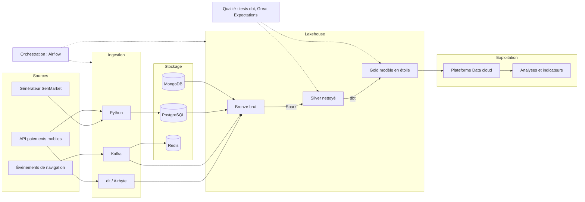
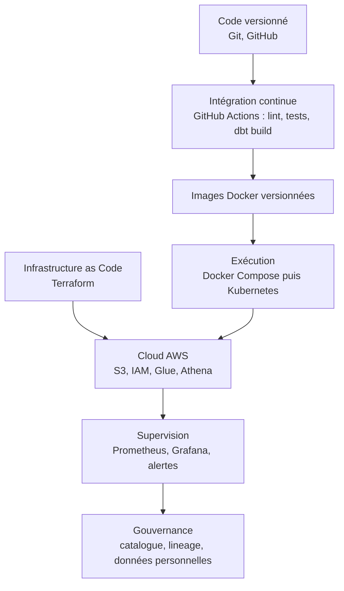
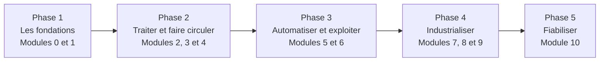
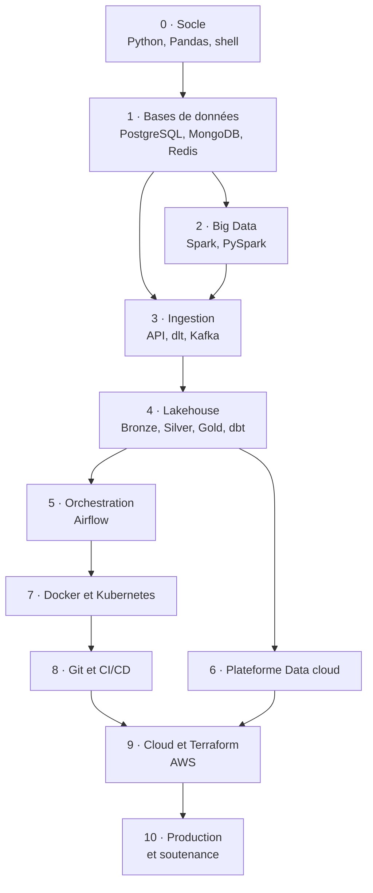
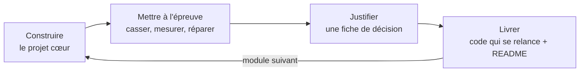

# SenMarket — Du premier script à la plateforme de données en production


> Un seul projet fil rouge, construit module après module : **SenMarket**, une marketplace sénégalaise fictive (clients, vendeurs, produits, commandes, paiements mobiles Wave et Orange Money, avis, navigation).
> Chaque module reprend ce que le précédent a produit, jusqu'à une plateforme de données **ingérée, transformée, testée, orchestrée, déployée et supervisée**.

Projet réalisé dans le cadre du parcours Data Engineering & Ops, Sonatel Académie / Orange Digital Center, Dakar.
*Les données sont entièrement synthétiques, les montants sont en francs CFA (XOF).*

---

## Sommaire

1. [Le but final](#1-le-but-final)
2. [Vue d'ensemble de la plateforme](#2-vue-densemble-de-la-plateforme)
3. [Le parcours en 5 phases](#3-le-parcours-en-5-phases)
4. [Les 11 modules](#4-les-11-modules)
5. [Comment chaque module se déroule](#5-comment-chaque-module-se-déroule)
6. [La stack technique](#6-la-stack-technique)
7. [Les compétences transversales](#7-les-compétences-transversales)
8. [Structure du dépôt](#8-structure-du-dépôt)
9. [Avancement](#9-avancement)
10. [Démarrer](#10-démarrer)

---

## 1. Le but final

Construire, casser, réparer et défendre **une plateforme de données complète**, de bout en bout :

| Savoir faire | Ce que ça veut dire concrètement |
|---|---|
| **Construire** | Du code de génération et d'ingestion jusqu'au modèle analytique |
| **Tester** | Tests unitaires, tests de données, contrôles de qualité qui bloquent le pipeline |
| **Déployer** | Conteneurs, Kubernetes, CI/CD, infrastructure décrite en code |
| **Superviser** | Métriques, tableaux de bord, alertes |
| **Diagnostiquer** | Lire des logs, retrouver la cause d'une panne, rejouer sans doublon |
| **Justifier** | Une fiche de décision par module : pourquoi cet outil, pourquoi ce choix |

Le parcours se termine par une **soutenance avec démonstration en direct** : un événement traverse la plateforme en temps réel, on affiche le tableau de bord, on provoque une panne et on la répare.

---

## 2. Vue d'ensemble de la plateforme

Architecture visée à la fin du parcours.



Ce qui entoure la plateforme et la rend exploitable en production :



---

## 3. Le parcours en 5 phases

Les modules s'enchaînent dans l'ordre où un projet de données se construit. On n'orchestre qu'une fois qu'on sait ce qu'il y a à orchestrer.



| Phase | Modules | Pourquoi à cet endroit |
|---|---|---|
| **Les fondations** | 0, 1 | On ne traite bien que ce qu'on comprend : d'abord le langage, puis la façon dont les données sont rangées |
| **Traiter et faire circuler** | 2, 3, 4 | Une fois le stockage compris, on traite de gros volumes, on les fait arriver, puis on les transforme en tables fiables |
| **Automatiser et exploiter** | 5, 6 | Un pipeline compris peut être orchestré, puis exploité sur une plateforme cloud |
| **Industrialiser** | 7, 8, 9 | Conteneurs, livraison automatique et cloud : tout devient reproductible, testé et déployable |
| **Fiabiliser** | 10 | Superviser, réparer, gouverner : le vrai métier quand le pipeline tourne pour de bon |

---

## 4. Les 11 modules

Chaque module construit sur le précédent. La colonne « Ce que SenMarket gagne » montre l'évolution du projet fil rouge.



| # | Module | Ce que SenMarket gagne | S'appuie sur |
|---|---|---|---|
| **0** | Socle : Python, données, shell | Des données réalistes et un dépôt Git | — |
| **1** | Bases de données relationnelles et NoSQL | Chaque donnée dans la bonne base | 0 |
| **2** | Big Data et calcul distribué | Un historique de plusieurs millions de lignes traité avec Spark | 0, 1 |
| **3** | Ingestion et intégration | Toutes les sources branchées, par lots et en continu | 1, 2 |
| **4** | Modélisation et transformation | Couches Bronze, Silver, Gold et modèle en étoile avec dbt | 3 |
| **5** | Orchestration avec Airflow | Le pipeline complet tourne tout seul | 2, 3, 4 |
| **6** | Plateformes Cloud Data | Le Gold chargé et comparé sur une plateforme | 4 |
| **7** | Docker et Kubernetes | Tout conteneurisé, puis déployé sur un cluster | 1 à 5 |
| **8** | Git, GitHub et CI/CD | Un dépôt propre, testé et livré automatiquement | 0 à 7 |
| **9** | Cloud et Infrastructure as Code | SenMarket sur AWS, décrit par du code | 4, 7, 8 |
| **10** | DataOps, gouvernance et projet final | Supervision, incidents, gouvernance, soutenance | Toute la plateforme |

---

## 5. Comment chaque module se déroule

Tous les modules suivent la même boucle, du cœur du sujet jusqu'à la défense du choix technique.



Chaque module distingue :

- **Les 3 priorités** : ce qu'on doit savoir construire, tester, diagnostiquer et expliquer seul.
- **L'optionnel** : outils et sujets à explorer selon le temps et le profil visé. Ils ne conditionnent pas la suite.

---

## 6. La stack technique

| Famille | À maîtriser | Optionnel |
|---|---|---|
| **Langages** | Python (Pandas, NumPy), SQL | Polars, PyArrow, Scala |
| **Bases de données** | PostgreSQL, MongoDB, Redis | Cassandra, HBase, Neo4j, DuckDB |
| **Big Data** | Spark et PySpark, concepts HDFS et MapReduce | Hive, YARN, Structured Streaming |
| **Ingestion** | Python (API, fichiers), dlt ou Airbyte, Kafka | NiFi, Debezium, Schema Registry |
| **Stockage et formats** | Parquet, couches Bronze / Silver / Gold | Iceberg, Delta Lake, MinIO, Data Vault |
| **Transformation et qualité** | dbt, Great Expectations | DuckDB, Polars, Soda |
| **Orchestration** | Airflow | Sensors, TaskFlow, Airflow sur Kubernetes |
| **Plateformes Data** | Une plateforme principale (Databricks) | Snowflake, BigQuery, Fabric |
| **Conteneurs** | Docker, Docker Compose, Kubernetes (bases) | Helm, k9s, Spark sur Kubernetes |
| **Versionnement et CI/CD** | Git, GitHub, GitHub Actions | Jenkins, GitLab CI, pre-commit |
| **Cloud et infrastructure** | AWS (S3, IAM, Glue, Athena), Terraform | Azure, Google Cloud, Ansible |
| **Supervision et gouvernance** | Prometheus, Grafana, DataHub ou OpenMetadata | Loki, ELK, OpenLineage |

---

## 7. Les compétences transversales

Elles ne sont pas dans un module précis : elles se construisent un peu partout, et elles font la différence entre utiliser des outils et savoir livrer un pipeline.

| Compétence | Où elle se travaille |
|---|---|
| Tests unitaires et d'intégration | Modules 0, 4, 8 |
| Gestion des erreurs et reprises | Modules 0, 3, 5 |
| Idempotence et chargements incrémentaux | Modules 3, 5 |
| Débogage et lecture des logs | Modules 5, 7, 10 |
| Optimisation des performances | Modules 1 (EXPLAIN), 2 (Spark UI), 6 |
| Gestion des coûts | Modules 6, 9, 10 |
| Résolution d'incidents | Modules 5, 10 |
| Justification des choix techniques | Chaque module, par une fiche de décision |

---

## 8. Structure du dépôt

```
senmarket/
├── README.md                 ce fichier : vue d'ensemble du parcours
├── .gitignore
├── module_0/                 Socle : Python, données, shell
│   ├── apprentissage/        notes et exercices d'apprentissage
│   └── projet/               le projet SenMarket du module (son propre README)
├── module_1/                 Bases de données             (à venir)
├── module_2/                 Big Data et Spark            (à venir)
├── module_3/                 Ingestion                    (à venir)
├── module_4/                 Lakehouse et dbt             (à venir)
├── module_5/                 Orchestration Airflow        (à venir)
├── module_6/                 Plateforme Data cloud        (à venir)
├── module_7/                 Docker et Kubernetes         (à venir)
├── module_8/                 Git et CI/CD                 (à venir)
├── module_9/                 Cloud et Terraform           (à venir)
└── module_10/                Production et soutenance     (à venir)
```

Chaque dossier de module contient son code, ses tests, sa fiche de décision et **son propre README**, qui explique comment l'exécuter. Ce README-ci reste volontairement au niveau du parcours.

---

## 9. Avancement

| Module | Statut |
|---|---|
| 0 · Socle | 🟡 En cours de finalisation |
| 1 · Bases de données | ⚪ À venir |
| 2 · Big Data | ⚪ À venir |
| 3 · Ingestion | ⚪ À venir |
| 4 · Lakehouse | ⚪ À venir |
| 5 · Airflow | ⚪ À venir |
| 6 · Plateforme Data cloud | ⚪ À venir |
| 7 · Docker et Kubernetes | ⚪ À venir |
| 8 · Git et CI/CD | ⚪ À venir |
| 9 · Cloud et Terraform | ⚪ À venir |
| 10 · Production et soutenance | ⚪ À venir |

Légende : 🟢 terminé · 🟡 en cours · ⚪ à venir

---

## 10. Démarrer

```bash
git clone https://github.com/abdoudjigo/senmarket.git
cd senmarket/module_0/projet
```

Puis suivre le `README.md` du module concerné pour l'installation et l'exécution.

**Prérequis généraux** : Linux (ou WSL / macOS), Python 3.12 recommandé, Git. Les modules suivants ajoutent Docker, un cluster local et un compte cloud avec crédits gratuits.

---

*Fil rouge SenMarket · Parcours Data Engineering & Ops · Sonatel Académie, Orange Digital Center*