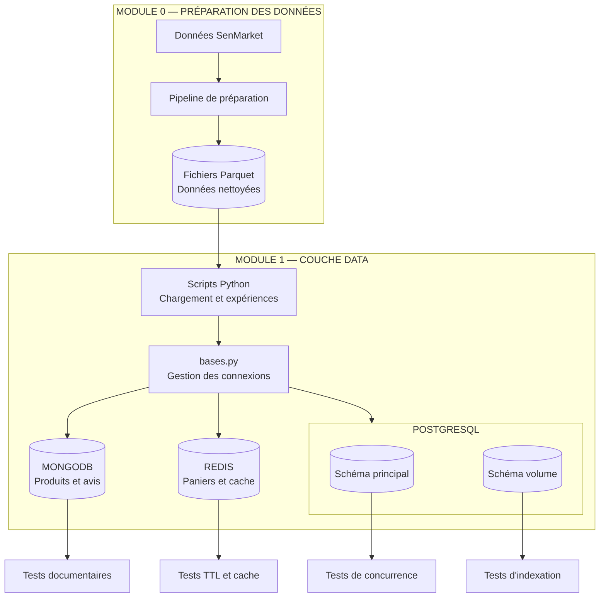
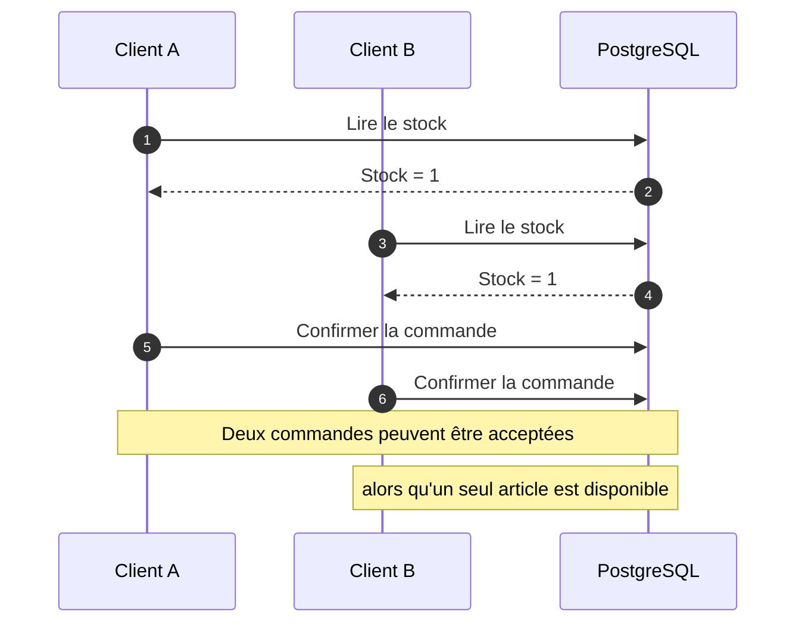
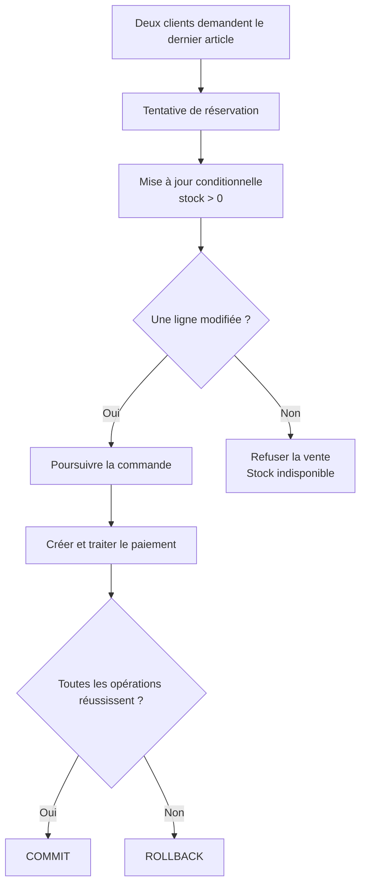
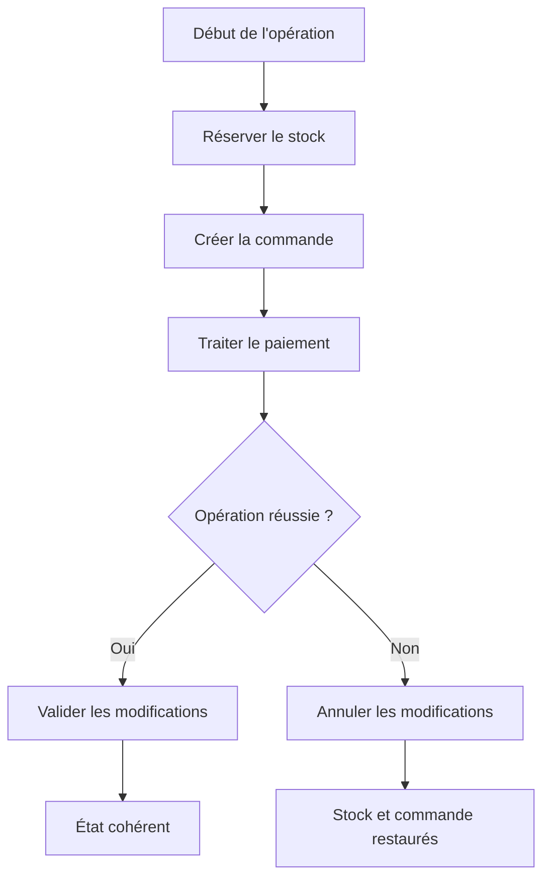
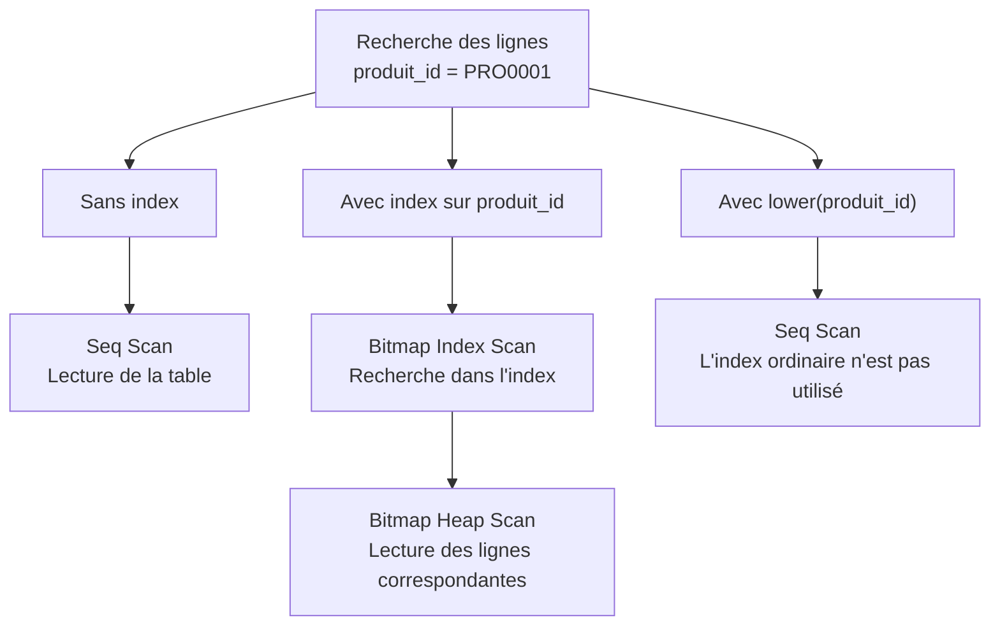
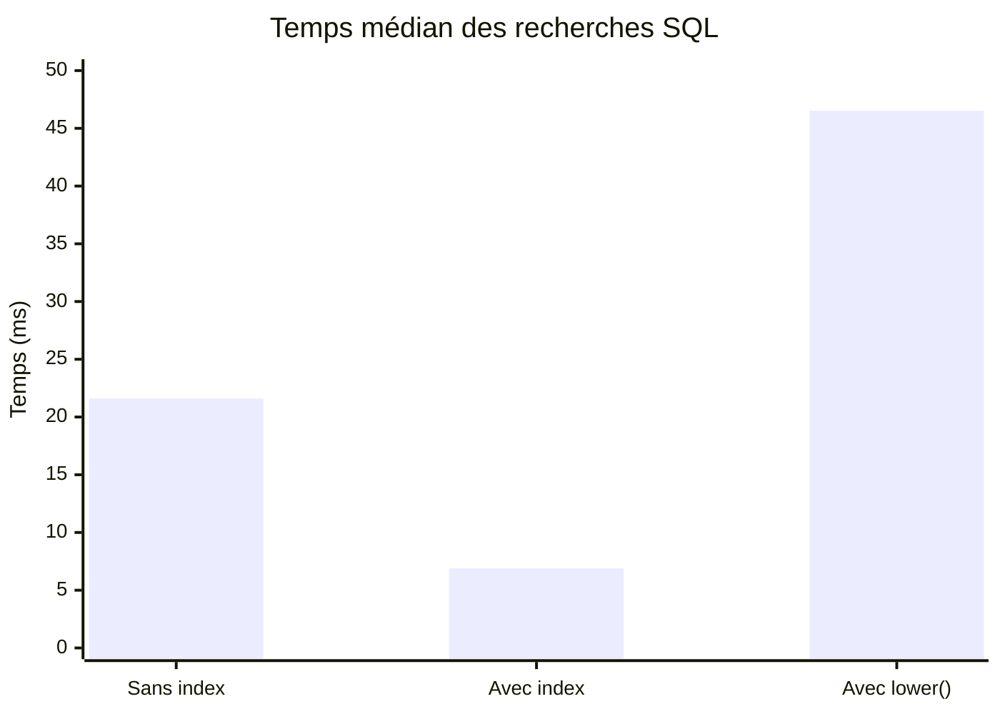
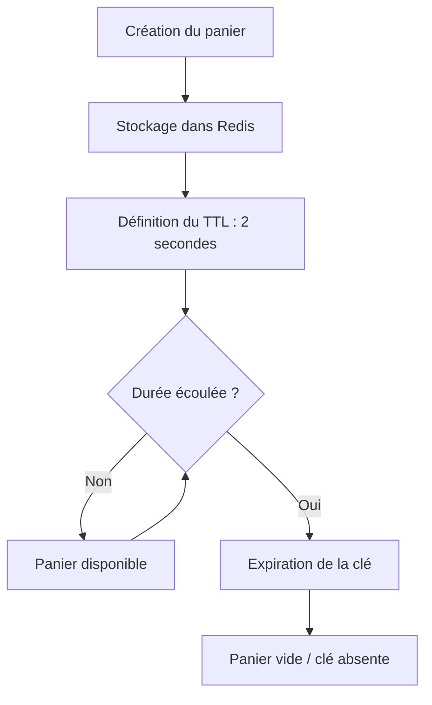
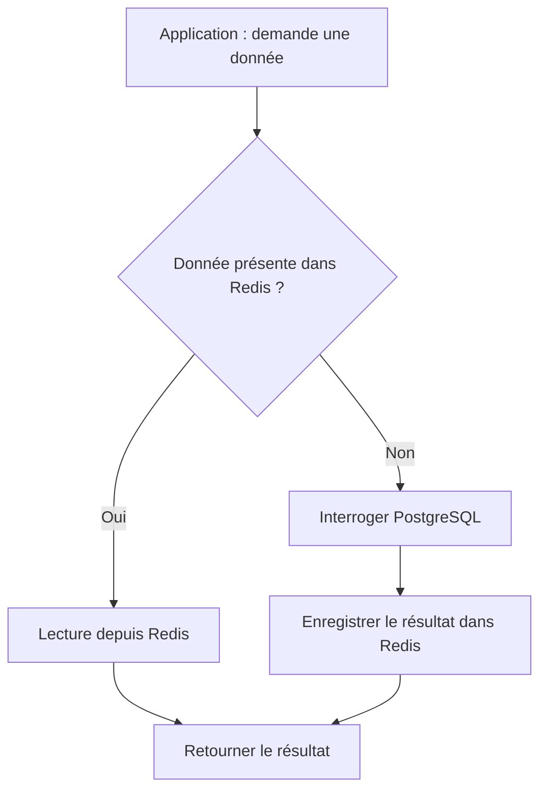
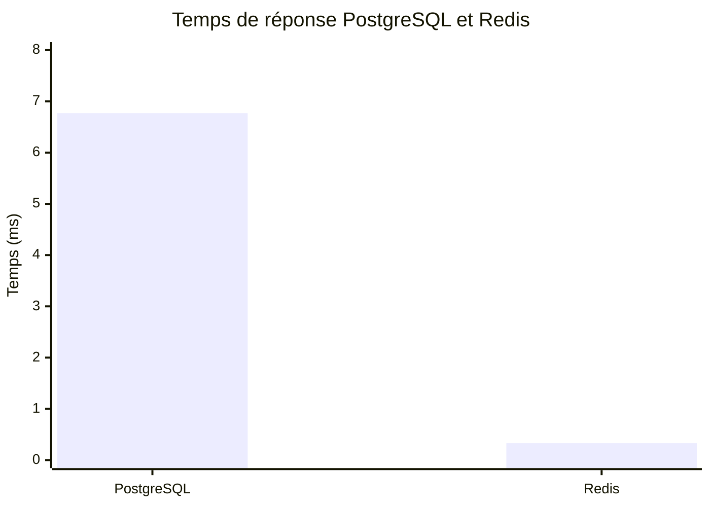
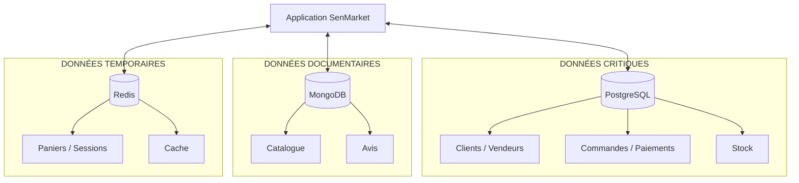

# SenMarket — Module 1
# Étude technique : architecture et choix des bases de données

<escape> </escape>

**Programme :** Data Engineering, Big Data & DataOps  
**Projet :** SenMarket — Marketplace e-commerce  
**Module :** 1 — Choisir ses bases de données  
**Périmètre technique :** PostgreSQL · MongoDB · Redis  
**Environnement :** Docker Compose · Python · Parquet  
**Statut :** Expériences exécutées — résultats consignés

---

## Sommaire

1. [Contexte et problématique](#1-contexte-et-problématique)
2. [Architecture générale](#2-architecture-générale)
3. [Répartition des données](#3-répartition-des-données)
4. [Préparation et chargement des données](#4-préparation-et-chargement-des-données)
5. [Expérience 1 — Concurrence et intégrité transactionnelle](#5-expérience-1--concurrence-et-intégrité-transactionnelle)
6. [Expérience 2 — Indexation et performances SQL](#6-expérience-2--indexation-et-performances-sql)
7. [Expérience 3 — Modélisation documentaire avec MongoDB](#7-expérience-3--modélisation-documentaire-avec-mongodb)
8. [Expérience 4 — Panier et cache avec Redis](#8-expérience-4--panier-et-cache-avec-redis)
9. [Synthèse des résultats](#9-synthèse-des-résultats)
10. [Limites et points de vigilance](#10-limites-et-points-de-vigilance)
11. [Décisions techniques finales](#11-décisions-techniques-finales)
12. [Conclusion](#12-conclusion)

---

# 1. Contexte et problématique

## 1.1 Présentation de SenMarket

SenMarket est une marketplace fictive inspirée du commerce en ligne sénégalais. La plateforme met en relation des clients et des vendeurs autour d'un catalogue de produits, de commandes et de paiements.

Son fonctionnement génère plusieurs catégories de données :

- Les informations des clients et des vendeurs.
- Les produits disponibles dans le catalogue.
- Les commandes et leurs lignes de détail.
- Les paiements associés aux commandes.
- Les avis et commentaires des clients.
- Les paniers et sessions des utilisateurs.
- Les données fréquemment consultées par l'application.

Ces données n'ont pas toutes les mêmes caractéristiques. Certaines exigent une cohérence stricte, d'autres nécessitent une structure flexible ou des temps de réponse très courts.

L'objectif n'est donc pas de choisir une base de données unique pour toute l'application, mais de déterminer quelle technologie répond le mieux aux besoins de chaque catégorie.

## 1.2 Les problèmes métier à résoudre

Trois situations concrètes orientent les choix techniques.

| Problème | Risque métier | Besoin technique |
|---|---|---|
| Deux clients commandent le dernier exemplaire d'un produit | Double vente et stock incohérent | Transactions et opérations atomiques |
| Les produits possèdent des caractéristiques différentes selon leur catégorie | Modèle relationnel difficile à faire évoluer | Structure documentaire flexible |
| Les paniers et les données populaires sont sollicités fréquemment | Temps de réponse élevé et charge sur la base principale | Stockage rapide et expiration automatique |

À ces problèmes s'ajoute une exigence transversale : les opérations doivent rester compréhensibles, reproductibles et vérifiables.

## 1.3 Objectifs techniques

Cette étude poursuit quatre objectifs :

1. Choisir une technologie adaptée à chaque catégorie de données.
2. Vérifier la cohérence des données chargées depuis le Module 0.
3. Expérimenter les mécanismes de concurrence, de transactions et d'indexation.
4. Comparer les usages de PostgreSQL, MongoDB et Redis sur des cas concrets.

**Principe directeur :** une technologie n'est pas retenue simplement parce qu'elle est performante ou populaire. Elle doit répondre à un besoin identifiable et apporter un bénéfice justifiable.

---

# 2. Architecture générale

## 2.1 Vue d'ensemble

L'architecture repose sur trois systèmes de stockage complémentaires :

- PostgreSQL pour les données transactionnelles et structurées.
- MongoDB pour le catalogue flexible et les avis.
- Redis pour les données temporaires et le cache.

Les données préparées par le Module 0 sont conservées en fichiers Parquet. Les scripts Python assurent les opérations de chargement, de connexion et les expérimentations.

### Diagramme 1 — Architecture logique



<escape> </escape>

**Lecture du diagramme :**

1. Le Module 0 prépare et nettoie les données.
2. Les fichiers Parquet constituent la source utilisée pour le chargement.
3. Les scripts Python pilotent les connexions et les opérations.
4. Les données sont réparties dans les trois systèmes selon leur nature.
5. Des expériences indépendantes permettent de vérifier les choix effectués.

Ce diagramme représente l'architecture logique du module, et non une architecture complète de production avec API, frontend et mécanismes de haute disponibilité.

## 2.2 Environnement technique

| Composant | Technologie | Rôle |
|---|---|---|
| Langage | Python | Chargement, connexions et expériences |
| Base relationnelle | PostgreSQL | Données transactionnelles |
| Base documentaire | MongoDB | Catalogue et avis |
| Base en mémoire | Redis | Panier et cache |
| Conteneurisation | Docker Compose | Démarrage des services |
| Format de données | Apache Parquet | Stockage des données préparées |
| Configuration | `.env` | Gestion des paramètres sensibles |

Les services sont déclarés dans `infra/docker-compose.yml`. Les connexions sont centralisées dans `scripts/bases.py`.

Les identifiants de connexion sont lus depuis `.env` plutôt que codés directement dans les scripts.

## 2.3 Organisation du code

```text
module_1/
│
├── README.md
│
├── docs/
│   ├── DECISIONS.md
│   └── TECHNICAL_STUDY.md
│
├── infra/
│   └── docker-compose.yml
│
├── sql/
│   └── 01_schema.sql
│
└── scripts/
    ├── bases.py
    ├── 1_charger.py
    ├── 2_double_vente.py
    ├── 3_index.py
    └── 4_mongo_redis.py
```

| Fichier | Responsabilité |
|---|---|
| `infra/docker-compose.yml` | Définition des trois services de stockage |
| `sql/01_schema.sql` | Définition du schéma relationnel |
| `scripts/bases.py` | Gestion des connexions |
| `scripts/1_charger.py` | Chargement des données dans PostgreSQL |
| `scripts/2_double_vente.py` | Expériences de concurrence et de plantage |
| `scripts/3_index.py` | Analyse des plans d'exécution et des index |
| `scripts/4_mongo_redis.py` | Expériences MongoDB et Redis |
| `docs/DECISIONS.md` | Synthèse des décisions d'architecture |
| `docs/TECHNICAL_STUDY.md` | Étude technique et résultats expérimentaux |

---

# 3. Répartition des données

## 3.1 Vue fonctionnelle

Le choix de la base dépend principalement de quatre critères :

- La structure des données.
- Le type d'accès attendu.
- Le niveau de cohérence nécessaire.
- Le comportement acceptable en cas d'indisponibilité.

| Catégorie | Technologie | Type de données | Besoin principal |
|---|---|---|---|
| Clients et vendeurs | PostgreSQL | Relationnelles | Intégrité des relations |
| Commandes et lignes | PostgreSQL | Relationnelles | Transactions |
| Paiements | PostgreSQL | Relationnelles | Cohérence financière |
| Stock | PostgreSQL | Relationnelles | Protection contre les ventes concurrentes |
| Fiches produits | MongoDB | Documentaires | Flexibilité du schéma |
| Avis | MongoDB | Documentaires | Documents autonomes et agrégations |
| Paniers | Redis | Clé-valeur / Hash | Rapidité et expiration |
| Cache des produits populaires | Redis | Clé-valeur | Réduction des lectures répétitives |

## 3.2 Frontière entre PostgreSQL et MongoDB

Un point important concerne les informations d'un produit.

La fiche descriptive et les données commerciales ne sont pas nécessairement stockées au même endroit.

**MongoDB conserve les caractéristiques variables du catalogue. PostgreSQL conserve les informations commerciales et transactionnelles critiques, notamment le prix utilisé dans les opérations de commande.**

Exemple de représentation documentaire :

```json
{
  "produit_id": "PRO0025",
  "nom": "Téléphone",
  "categorie": "Électronique",
  "attributs": {
    "specs": {
      "ram_go": 4,
      "stockage_go": 64
    },
    "couleurs": ["noir", "bleu"],
    "garantie_mois": 12
  }
}
```

Un produit alimentaire peut posséder une structure différente :

```json
{
  "produit_id": "PRO0001",
  "nom": "Riz brisé",
  "categorie": "Alimentation",
  "attributs": {
    "poids_kg": 1,
    "origine": "Sénégal"
  }
}
```

Le champ `produit_id` permet de retrouver le produit correspondant dans PostgreSQL.

Il s'agit d'un identifiant de rapprochement entre deux bases distinctes, et non d'une clé étrangère PostgreSQL contrôlant automatiquement MongoDB.

## 3.3 Pourquoi ne pas tout mettre dans PostgreSQL ?

PostgreSQL propose également JSONB, des index et de nombreuses possibilités d'optimisation.

Il serait donc incorrect de considérer que PostgreSQL est incapable de gérer un catalogue flexible ou des données temporaires.

Le choix de MongoDB et Redis est fondé sur leurs usages dans ce projet :

| Besoin | PostgreSQL pourrait-il le gérer ? | Pourquoi conserver une autre technologie ? |
|---|---|---|
| Attributs produits variables | Oui, avec JSONB | Modèle documentaire adapté aux fiches autonomes |
| Avis | Oui | Documents et agrégations séparés du catalogue |
| Panier temporaire | Oui | Redis apporte des structures en mémoire et un TTL natif |
| Cache | Oui, avec d'autres mécanismes | Redis fournit un stockage dédié aux accès rapides |

**Décision :** conserver trois technologies uniquement parce qu'elles répondent à des besoins identifiés. Leur présence entraîne aussi davantage de services à surveiller, sécuriser et maintenir.

---

# 4. Préparation et chargement des données

## 4.1 Source des données

Le Module 1 s'appuie sur les données préparées par le Module 0.

Ces données sont stockées au format Parquet et servent de référence pour les chargements.

Le module utilise deux schémas PostgreSQL :

- `principal` : partition de taille réduite.
- `volume` : partition de taille plus importante.

Cette séparation permet d'observer le comportement des opérations sur deux volumes de données différents.

## 4.2 Chargement PostgreSQL

Commande :

```bash
python scripts/1_charger.py \
    --run-date 2026-10-29 \
    --schema principal

python scripts/1_charger.py \
    --run-date 2026-11-02 \
    --schema volume
```

Le script affiche, pour chaque table, le nombre de lignes attendu dans le Parquet et le nombre de lignes présent dans PostgreSQL.

### Résultats observés

| Table | Principal — Parquet | Principal — PostgreSQL | Volume — Parquet | Volume — PostgreSQL |
|---|---:|---:|---:|---:|
| Vendeurs | 20 | 20 | 20 | 20 |
| Clients | 3 333 | 3 333 | 50 000 | 50 000 |
| Produits | 40 | 40 | 40 | 40 |
| Commandes | 4 084 | 4 084 | 80 876 | 80 876 |
| Lignes de commande | 9 995 | 9 995 | 199 997 | 199 997 |
| Paiements | 4 002 | 4 002 | 79 264 | 79 264 |

### Vérification financière

| Indicateur | Principal | Volume |
|---|---:|---:|
| Somme des montants dans les données de référence | 163 011 763 XOF | 3 130 055 446 XOF |
| Somme des montants dans PostgreSQL | 163 011 763 XOF | 3 130 055 446 XOF |
| Résultat | Identique | Identique |

### Temps de chargement

| Schéma | Temps mesuré |
|---|---:|
| `principal` | 0,6 seconde |
| `volume` | 8,5 secondes |

### Interprétation

Les comptes des six tables affichées sont identiques entre les fichiers Parquet et PostgreSQL.

La somme des montants est également identique dans les deux environnements.

Cela constitue une preuve de cohérence pour les indicateurs contrôlés.

Le temps de chargement augmente avec le volume de données. Cependant, ces deux mesures ne suffisent pas à établir une relation de performance générale : elles dépendent aussi de la machine, du système de stockage, des index et de l'environnement d'exécution.

**Point de vigilance :** une comparaison des comptes et des sommes ne démontre pas à elle seule l'absence de doublons ou l'intégrité de toutes les colonnes.

Pour valider complètement l'idempotence, il faut relancer le chargement avec les mêmes paramètres et vérifier que les comptes et les sommes restent inchangés.

---

# 5. Expérience 1 — Concurrence et intégrité transactionnelle

## 5.1 Problématique

Un produit SenMarket possède un stock disponible d'une seule unité.

Deux clients souhaitent acheter ce produit au même moment.

Si les deux opérations lisent le stock avant que l'une d'elles ne le modifie, elles peuvent toutes les deux considérer qu'un exemplaire est disponible.

Le système risque alors de confirmer deux commandes pour une seule unité.

Ce problème est appelé **condition de concurrence** (*race condition*).

## 5.2 Scénario de double vente

Le produit utilisé pour l'expérience est `PRO0025`.

Son stock initial est de 1.

### Diagramme 2 — Risque dans une approche naïve



Le problème ne vient pas nécessairement d'une erreur SQL.

Il vient du fait que la lecture du stock et sa modification ne sont pas suffisamment protégées contre les opérations concurrentes.

## 5.3 Approche sûre

La version sûre doit empêcher deux opérations concurrentes de consommer la même unité de stock.

Le principe consiste à associer la vérification du stock et sa décrémentation à une opération protégée, avec une transaction adaptée.

Une mise à jour conditionnelle du stock peut notamment suivre cette logique :

```sql
UPDATE produits
SET stock = stock - 1
WHERE produit_id = 'PRO0025'
  AND stock > 0;
```

L'application doit ensuite vérifier le nombre de lignes modifiées :

- Une ligne modifiée : l'unité a été réservée.
- Aucune ligne modifiée : le stock n'est plus disponible.

La transaction permet de regrouper les opérations liées à la commande et au paiement afin de pouvoir valider l'ensemble ou annuler les modifications en cas d'échec.

> Ce fragment SQL illustre le principe de la mise à jour conditionnelle. Il ne remplace pas l'implémentation complète du script.

### Diagramme 3 — Principe de la version sûre



Le point essentiel est que l'opération de réservation ne doit pas être réalisée à partir d'une simple lecture non protégée suivie d'une écriture indépendante.

## 5.4 Résultats de la double vente

Le script exécute 200 essais avec deux acheteurs et un stock initial de 1.

| Indicateur | Approche naïve | Approche sûre |
|---|---:|---:|
| Doubles ventes | 200 | 0 |
| Refus | 0 | 200 |

<escape> </escape>

<escape> </escape>

**Résultat :** dans les conditions de simulation, la version naïve produit une double vente à chaque essai, tandis que la version sûre n'en produit aucune.

## 5.5 Simulation de plantage entre commande et paiement

Une deuxième expérience étudie un autre problème : une erreur survient après la création de la commande, mais avant la finalisation du paiement.

Sans transaction adaptée, le système peut conserver une commande non payée et un stock déjà débité.

### Diagramme 4 — Cohérence entre commande, paiement et stock



### Résultats observés

| Indicateur sur 50 essais | Approche naïve | Approche sûre |
|---|---:|---:|
| Commandes sans paiement | 50 | 0 |
| Stock débité sans paiement | 50 | 0 |

### Interprétation

Dans la version naïve, les opérations peuvent laisser un état incomplet.

La version sûre évite les incohérences observées dans les scénarios testés.

Une transaction PostgreSQL apporte notamment deux propriétés importantes :

- **Atomicité :** les opérations regroupées sont validées ensemble ou annulées ensemble.
- **Cohérence :** les contraintes et règles définies doivent rester respectées après validation.

La transaction ne remplace cependant pas une intégration complète avec un prestataire de paiement externe. Dans une véritable application, les appels à Wave ou Orange Money nécessitent également une gestion des erreurs, de l'idempotence et des états de paiement asynchrones.

## 5.6 Conclusion de l'expérience

Le stock et les commandes représentent des données critiques.

Une erreur de disponibilité peut avoir des conséquences commerciales et financières.

PostgreSQL est donc retenu pour gérer ces données avec ses mécanismes relationnels et transactionnels.

**Décision :** le stock ne doit pas dépendre de Redis comme source de vérité.

---

# 6. Expérience 2 — Indexation et performances SQL

## 6.1 Problématique

Une base relationnelle peut contenir des centaines de milliers de lignes.

Lorsqu'une application recherche régulièrement les commandes ou les lignes correspondant à un produit, une lecture complète de la table peut devenir coûteuse.

L'index permet de fournir au moteur un chemin d'accès supplémentaire vers les données.

## 6.2 Scénario expérimental

Le test est réalisé sur une table contenant :

**199 997 lignes.**

La requête recherche toutes les lignes associées au produit `PRO0001`.

Résultat attendu :

**11 450 lignes.**

L'expérience compare trois situations :

1. Une recherche sans index dédié.
2. Une recherche après création d'un index sur `produit_id`.
3. Une recherche utilisant `lower(produit_id)` alors que l'index ordinaire porte sur `produit_id`.

## 6.3 Résultats des plans d'exécution

| Situation | Plan d'exécution | Temps médian |
|---|---|---:|
| Avant index | `Seq Scan` | 21,60 ms |
| Après index | `Bitmap Heap Scan` + `Bitmap Index Scan` | 6,91 ms |
| Index présent avec `lower(produit_id)` | `Seq Scan` | 46,53 ms |

### Diagramme 5 — Comparaison des plans



## 6.4 Analyse du gain

Le temps médian passe de 21,60 ms à 6,91 ms.

Le facteur d'accélération mesuré est :

\[
Gain = \frac{21,60}{6,91} \approx 3,13
\]

Soit environ **3,1 fois plus rapide** dans cette expérience.

La taille de l'index est de **1 384 kB**.

### Pourquoi PostgreSQL utilise-t-il un Bitmap Scan ?

Un index n'est pas nécessairement utilisé sous la forme d'un `Index Scan` classique.

PostgreSQL peut utiliser un `Bitmap Index Scan` pour identifier les emplacements des lignes correspondantes, puis un `Bitmap Heap Scan` pour récupérer les lignes dans la table.

Cette stratégie peut être pertinente lorsqu'une requête retourne un nombre relativement important de lignes.

Ici, 11 450 lignes sont concernées sur 199 997, soit environ 5,7 % de la table.

## 6.5 Le contre-exemple : lower()

La troisième situation utilise une expression :

```sql
WHERE lower(produit_id) = 'pro0001'
```

L'index ordinaire porte sur `produit_id`, tandis que la requête utilise une expression appliquée à cette colonne.

Le plan observé est un `Seq Scan`.

Le temps mesuré atteint 46,53 ms.

Cela montre qu'un index présent dans une table ne garantit pas son utilisation par toutes les requêtes.

Une solution possible, selon le besoin fonctionnel, serait un index d'expression :

```sql
CREATE INDEX idx_produits_lower_id
ON produits (lower(produit_id));
```

Cet index supplémentaire n'est pas le résultat de l'expérience réalisée : il s'agit d'une piste d'optimisation à tester séparément.

## 6.6 Comparaison visuelle des temps



## 6.7 Conclusion de l'expérience

L'index améliore significativement la recherche testée.

Cependant, il faut distinguer trois éléments :

- L'existence d'un index.
- La capacité du moteur à utiliser cet index pour une requête donnée.
- Le coût total de cet index en stockage et en maintenance lors des écritures.

Un index peut accélérer les lectures, mais il occupe de l'espace et peut ralentir certaines opérations d'insertion, de mise à jour et de suppression.

**Décision :** indexer les colonnes réellement utilisées dans les recherches fréquentes, puis vérifier le plan avec `EXPLAIN` ou `EXPLAIN ANALYZE` plutôt que de créer des index systématiquement.

---

# 7. Expérience 3 — Modélisation documentaire avec MongoDB

## 7.1 Problématique

Le catalogue SenMarket contient plusieurs catégories de produits.

Un téléphone, un sac de riz ou un vêtement ne possèdent pas les mêmes caractéristiques.

Dans un modèle relationnel classique, une table unique pourrait nécessiter de nombreuses colonnes spécifiques, dont certaines resteraient souvent vides.

MongoDB permet de représenter chaque produit sous forme de document.

## 7.2 Données chargées

| Élément | Résultat |
|---|---:|
| Produits | 40 |
| Avis | 999 |

## 7.3 Structure des documents

Exemple d'un produit électronique :

```json
{
  "produit_id": "PRO0025",
  "nom": "Téléphone",
  "categorie": "Électronique",
  "attributs": {
    "specs": {
      "ram_go": 4,
      "stockage_go": 64
    },
    "couleurs": ["noir", "bleu"],
    "garantie_mois": 12
  }
}
```

Exemple d'un produit alimentaire :

```json
{
  "produit_id": "PRO0001",
  "nom": "Riz brisé",
  "categorie": "Alimentation",
  "attributs": {
    "poids_kg": 1,
    "origine": "Sénégal"
  }
}
```

### Comparaison des structures

| Critère | Téléphone | Riz brisé |
|---|---|---|
| Catégorie | Électronique | Alimentation |
| Objet imbriqué | `specs` | Aucun dans l'exemple |
| Attributs spécifiques | RAM, stockage | Poids, origine |
| Tableau | Couleurs | Aucun dans l'exemple |
| Structure | Plus détaillée | Plus simple |

L'intérêt de cette représentation est de conserver les caractéristiques utiles à chaque catégorie sans imposer une structure identique à tous les produits.

## 7.4 Validation des documents

La flexibilité de MongoDB ne signifie pas que toutes les données doivent être acceptées.

Un validateur permet d'imposer des règles de structure et de type.

Dans l'expérience, un avis contenant une note de 9 est refusé.

**Résultat :**

| Test | Résultat |
|---|---|
| Avis avec note valide | Acceptation attendue |
| Avis avec note égale à 9 | Refusé par le validateur |

Le refus montre que le modèle documentaire peut conserver une certaine flexibilité tout en appliquant des règles de validation.

## 7.5 Agrégation des avis

Le script calcule le classement des produits les mieux notés, en conservant uniquement les produits ayant au moins cinq avis.

Résultat observé :

| Rang | Produit | Note moyenne | Nombre d'avis |
|---:|---|---:|---:|
| 1 | PRO0035 | 3,70 | 10 |
| 2 | PRO0004 | 3,54 | 52 |
| 3 | PRO0031 | 3,38 | 8 |

Ce résultat illustre l'intérêt des agrégations pour transformer des documents individuels en indicateurs exploitables.

## 7.6 Conclusion de l'expérience

MongoDB est utilisé pour deux besoins distincts :

- Les fiches produits, dont la structure varie selon la catégorie.
- Les avis, qui sont des documents autonomes pouvant être agrégés par produit.

Le catalogue conserve un identifiant `produit_id` permettant de faire le lien avec les informations relationnelles.

Le prix et le stock ne doivent pas être dupliqués comme sources de vérité dans MongoDB : leur gestion reste dans PostgreSQL.

**Décision :** utiliser MongoDB pour la description flexible des produits et les avis, sans déplacer les données commerciales critiques.

---

# 8. Expérience 4 — Panier et cache avec Redis

## 8.1 Problématique

Certains éléments de l'application sont temporaires et sollicités très fréquemment.

Le panier d'un client peut évoluer à chaque interaction. Une page populaire peut également déclencher plusieurs lectures identiques.

Utiliser systématiquement PostgreSQL pour tous ces accès peut ajouter une charge inutile sur la base transactionnelle.

Redis apporte un stockage en mémoire adapté aux accès rapides et aux données temporaires.

## 8.2 Expiration automatique du panier

Redis propose le mécanisme de TTL (*Time To Live*).

Le TTL définit la durée pendant laquelle une clé reste disponible avant son expiration automatique.

Dans l'expérience, le panier est créé avec une durée de vie de deux secondes.

### Résultat observé

| Moment | État du panier |
|---|---|
| Création | Panier contenant deux produits |
| Après 2 secondes | Expiration prévue |
| Après 3 secondes | Panier vide |

Contenu du panier au départ :

```json
{
  "PRO0001": "2",
  "PRO0003": "1"
}
```

Le test démontre qu'une donnée temporaire peut disparaître automatiquement sans intervention manuelle.

### Diagramme 6 — Cycle de vie du panier



## 8.3 Cache devant PostgreSQL

Le deuxième test utilise le modèle **Cache-Aside**.

Son principe est simple :

1. L'application cherche la donnée dans Redis.
2. Si la donnée est absente, elle interroge PostgreSQL.
3. Le résultat est enregistré dans Redis.
4. Les requêtes suivantes peuvent utiliser la valeur mise en cache.

### Diagramme 7 — Fonctionnement du Cache-Aside



## 8.4 Résultats mesurés

| Appel | Source de la réponse | Temps |
|---|---|---:|
| Premier appel | PostgreSQL | 6,77 ms |
| Deuxième appel | Redis | 0,33 ms |

Le facteur d'accélération mesuré est :

\[
Gain = \frac{6,77}{0,33} \approx 20,52
\]

Le deuxième appel est donc environ **20,5 fois plus rapide** dans cette expérience.

### Diagramme 8 — Temps de réponse



## 8.5 Interprétation

Redis réduit le temps de réponse du deuxième appel dans le scénario testé.

Cela ne signifie pas que Redis remplace PostgreSQL.

Les deux systèmes ont des responsabilités différentes :

| Critère | PostgreSQL | Redis |
|---|---|---|
| Rôle | Stockage principal | Stockage temporaire / cache |
| Données | Commandes, paiements, stock | Panier, sessions, cache |
| Accès | Requêtes relationnelles | Accès en mémoire |
| Durée de vie | Données métier persistantes | Données pouvant expirer |
| Source de vérité du stock | Oui | Non |

Un cache peut devenir obsolète si les données de référence changent.

Il faut donc définir une stratégie d'invalidation ou d'expiration adaptée au besoin métier.

**Décision :** Redis est utilisé pour les données temporaires et le cache, sans devenir la source de vérité des informations critiques.

---

# 9. Synthèse des résultats

## 9.1 Tableau récapitulatif

| Expérience | Indicateur | Résultat |
|---|---|---|
| Chargement PostgreSQL | Comptes des six tables | Identiques au Parquet |
| Chargement PostgreSQL | Sommes des montants | Identiques au Parquet |
| Chargement PostgreSQL | Durée principal | 0,6 s |
| Chargement PostgreSQL | Durée volume | 8,5 s |
| Double vente | Approche naïve | 200 doubles ventes sur 200 essais |
| Double vente | Approche sûre | 0 double vente |
| Plantage | Approche naïve | 50 commandes sans paiement sur 50 essais |
| Plantage | Approche sûre | 0 commande sans paiement |
| Index | Temps avant index | 21,60 ms |
| Index | Temps après index | 6,91 ms |
| Index | Gain mesuré | ×3,1 |
| MongoDB | Produits chargés | 40 |
| MongoDB | Avis chargés | 999 |
| MongoDB | Note égale à 9 | Refusée |
| Redis | Expiration du panier | 2 secondes |
| Redis | Temps PostgreSQL | 6,77 ms |
| Redis | Temps Redis | 0,33 ms |
| Redis | Gain mesuré | ×20,5 |

## 9.2 Ce que les expériences démontrent

| Besoin | Enseignement |
|---|---|
| Cohérence des données | Comparer les comptes et les sommes avec la source de référence |
| Concurrence | Une lecture suivie d'une écriture non protégée peut produire une incohérence |
| Transactions | Regrouper les opérations métier qui doivent réussir ou échouer ensemble |
| Indexation | Un index peut réduire le coût d'une recherche, mais le planificateur reste décisionnaire |
| Documents flexibles | Les catégories de produits peuvent posséder des attributs différents |
| Validation | Un modèle flexible peut tout de même imposer des règles |
| TTL | Les données temporaires peuvent expirer automatiquement |
| Cache | Une donnée fréquemment consultée peut être servie depuis Redis plutôt que recalculée ou relue |

## 9.3 Comparaison des technologies

| Technologie | Force principale dans SenMarket | Données concernées | Limite à surveiller |
|---|---|---|---|
| PostgreSQL | Intégrité relationnelle et transactions | Commandes, paiements, stock | Coût des requêtes et des index à surveiller |
| MongoDB | Modèle documentaire flexible | Catalogue et avis | Validation et cohérence avec les données PostgreSQL |
| Redis | Accès rapide et expiration | Paniers et cache | Perte possible des données temporaires |

---

# 10. Limites et points de vigilance

Une expérience réussie ne signifie pas qu'une architecture est automatiquement prête pour la production.

Les résultats doivent être interprétés en fonction du protocole utilisé.

## 10.1 Limites des mesures de performance

Les temps obtenus dépendent notamment :

- Du matériel utilisé.
- De la mémoire disponible.
- De la charge des services.
- De l'état du cache système.
- Du nombre de répétitions.
- De la taille des données.

Les valeurs de 6,91 ms et 0,33 ms sont des mesures locales. Elles ne doivent pas être présentées comme des performances garanties dans un environnement de production.

## 10.2 Limites des tests de concurrence

Le test démontre un comportement dans le scénario simulé.

Il ne remplace pas un test de charge complet avec un grand nombre de clients, des délais réseau variables et des processus distribués.

Il faut également vérifier le mécanisme exact utilisé dans le script pour garantir que la protection repose bien sur les transactions et les opérations atomiques attendues.

## 10.3 Limites de la cohérence entre bases

PostgreSQL et MongoDB stockent des informations liées par `produit_id`.

Cependant, une relation logique entre deux bases ne constitue pas une transaction distribuée.

Une modification dans PostgreSQL n'entraîne pas automatiquement une modification dans MongoDB.

Une application réelle devra prévoir une stratégie de synchronisation et de gestion des erreurs.

## 10.4 Tests complémentaires non couverts par les résultats actuels

| Test complémentaire | Objectif | État |
|---|---|---|
| Relancer le chargeur avec la même partition | Prouver l'idempotence | À confirmer par un second chargement |
| Couper PostgreSQL | Vérifier le comportement de l'application | Non documenté ici |
| Couper MongoDB | Vérifier la disponibilité du catalogue et des avis | Non documenté ici |
| Redémarrer Redis | Vérifier la perte et la reconstruction des données temporaires | Non documenté ici |
| Tester plusieurs charges concurrentes | Évaluer le comportement sous charge | Non réalisé dans les résultats présentés |
| Tester DuckDB sur les fichiers Parquet | Comparer les résultats analytiques | Hors périmètre des scripts présentés |
| Mesurer le coût d'écriture des index | Évaluer leur impact sur les chargements | Non mesuré ici |

Ces points constituent des pistes d'amélioration et ne remettent pas en cause les observations déjà obtenues.

---

# 11. Décisions techniques finales

À l'issue des expériences, les décisions retenues sont les suivantes :

| Décision | Technologie | Justification |
|---|---|---|
| Stocker les clients et les vendeurs | PostgreSQL | Relations et intégrité |
| Stocker les commandes et paiements | PostgreSQL | Transactions et cohérence |
| Gérer le stock | PostgreSQL | Prévention des doubles ventes |
| Stocker les fiches produits | MongoDB | Attributs variables |
| Stocker les avis | MongoDB | Documents autonomes et agrégations |
| Gérer les paniers | Redis | Accès rapide et TTL |
| Mettre en cache les données populaires | Redis | Réduction des lectures répétitives |

## 11.1 Architecture cible retenue



Cette architecture sépare les responsabilités tout en conservant PostgreSQL comme base de référence pour les opérations commerciales critiques.

## 11.2 Règle de conception

> Une base supplémentaire doit répondre à un besoin clairement identifié. Si PostgreSQL peut répondre correctement au besoin avec une complexité raisonnable, l'ajout d'un autre système doit être justifié par un bénéfice mesurable.

---

# 12. Conclusion

Ce premier module a permis de passer d'un choix théorique de technologies à une architecture justifiée par des expériences réalisées sur les données SenMarket.

PostgreSQL a été retenu pour les données relationnelles et transactionnelles. Les tests de concurrence montrent pourquoi le stock doit être protégé contre les opérations simultanées et pourquoi les opérations métier liées doivent être traitées de manière cohérente.

MongoDB apporte une représentation documentaire adaptée aux caractéristiques variables du catalogue et aux avis des clients.

Redis répond aux besoins de rapidité et de gestion des données temporaires grâce au stockage en mémoire, au TTL et au cache-aside.

Les expériences ont également montré que les performances doivent être mesurées et interprétées : un index peut améliorer une requête, mais son utilisation dépend du plan choisi par PostgreSQL ; un cache peut réduire le temps de réponse, mais il ne remplace pas la base principale.

**La décision finale n'est donc pas de multiplier les bases, mais d'attribuer à chaque technologie une responsabilité précise, cohérente avec les besoins métier de SenMarket.**

---

*Fin de l'étude technique — SenMarket, Module 1.*

