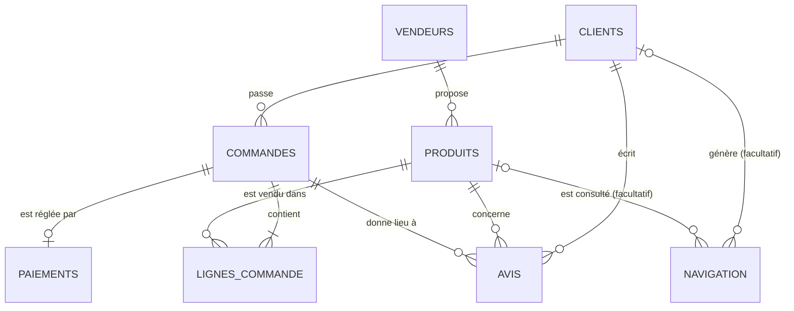

# Contrat de données SenMarket (Module 0)

Ce document décrit exactement ce que contiennent les 8 tables : colonnes, types, clés, relations, unités et règles métier. Les Modules 1 à 4 s'appuient dessus. L'utilisation du pipeline est dans le `README.md`.

## 1. Trois décisions prises avant de générer quoi que ce soit

**Granularité.** Une ligne de `commandes` est un ticket entier. Une ligne de `lignes_commande` est un produit dans ce ticket. Le « panier » d'une commande est donc la somme de ses lignes, jamais la valeur d'une seule ligne.

**Identifiants.** Chaque entité a un identifiant texte stable avec préfixe : `CLI`, `VEN`, `PRD`, `CMD`, `LIG`, `PAI`, `AVI`, `NAV` suivis de 7 chiffres (ex. `CMD0000001`). Un nom n'est jamais une clé : deux clients homonymes seraient fusionnés.

**Prix.** Le prix de catalogue est dans `produits`. Le prix payé est dans `lignes_commande` et peut différer du catalogue (promotion jusqu'à ±10 %). Le catalogue peut changer sans réécrire l'historique.

## 2. Schéma des relations

## 3. Les tables

Types : texte, entier, date (AAAA-MM-JJ), horodatage, booléen. PK = clé primaire, FK = clé étrangère.

### clients (une ligne = un client)
| Colonne | Type | Règle |
|---|---|---|
| client_id | texte, PK | `CLI0000001` |
| nom_client | texte | « Inconnu » si absent |
| email | texte, facultatif | construit à partir du nom et du numéro du client (unique) ; donnée personnelle synthétique |
| telephone | texte, facultatif | format `+221 7x xxx xx xx` ; donnée personnelle synthétique |
| ville, region | texte | « Inconnue » si absente (affichée à part dans les analyses) |
| date_inscription | date | |

### vendeurs (une ligne = un vendeur)
| Colonne | Type | Règle |
|---|---|---|
| vendeur_id | texte, PK | `VEN0000001` |
| nom_vendeur, ville, region | texte | |

### produits (une ligne = un produit du catalogue)
| Colonne | Type | Règle |
|---|---|---|
| produit_id | texte, PK | `PRD0000001` |
| nom_produit | texte | appartient obligatoirement à sa catégorie (voir §6) |
| categorie | texte | |
| vendeur_id | texte, FK → vendeurs | |
| prix_catalogue_xof | entier | entre 1 000 et 500 000 ; rejeté si ≤ 0 ou > 1 000 000 |
| actif | booléen | |

### commandes (une ligne = un ticket entier)
| Colonne | Type | Règle |
|---|---|---|
| commande_id | texte, PK | `CMD0000001` |
| client_id | texte, FK → clients | |
| date_commande | date | ≥ date_inscription du client ; jamais postérieure à `--run-date` |
| statut | texte | `livree`, `expediee`, `en_cours`, `annulee` |

### lignes_commande (une ligne = un produit dans un ticket)
| Colonne | Type | Règle |
|---|---|---|
| ligne_commande_id | texte, PK | `LIG0000001`, différent pour chaque ligne |
| commande_id | texte, FK → commandes | identique pour toutes les lignes d'un même ticket |
| produit_id | texte, FK → produits | |
| quantite | entier | > 0 (surtout 1 ou 2, jusqu'à 5) |
| prix_unitaire_xof | entier | prix réellement payé |
| montant_xof | entier | = quantite × prix_unitaire_xof |

### paiements (une ligne = une tentative de paiement)
| Colonne | Type | Règle |
|---|---|---|
| paiement_id | texte, PK | `PAI0000001` |
| commande_id | texte, FK → commandes | |
| methode_paiement | texte | `wave`, `orange_money`, `carte`, `especes` |
| statut_paiement | texte | `reussi`, `echoue`, `en_attente` |
| montant_xof | entier | ≥ 0 |
| date_paiement | date | |

Écarts métier voulus (ce ne sont pas des défauts, ils ne vont pas en quarantaine) : environ 2 % de commandes sans paiement, environ 1 % de paiements dont le montant diffère de la somme des lignes (frais, remise).

### avis (une ligne = un avis client)
| Colonne | Type | Règle |
|---|---|---|
| avis_id | texte, PK | `AVI0000001` |
| client_id, produit_id, commande_id | texte, FK | le produit fait partie de la commande ; le client est celui de la commande |
| note | entier | de 1 à 5 |
| date_avis | date | ≥ date_commande |

### navigation (une ligne = un événement de navigation)
| Colonne | Type | Règle |
|---|---|---|
| evenement_id | texte, PK | `NAV0000001` |
| session_id | texte | |
| client_id | texte, FK, facultatif | vide = session anonyme |
| produit_id | texte, FK, facultatif | |
| type_evenement | texte | `vue_produit`, `ajout_panier`, `debut_paiement` |
| date_evenement | horodatage | |

## 4. Un ticket, deux tables

Le ticket `CMD0000001` est 1 ligne dans `commandes` et 3 lignes dans `lignes_commande` :

| ligne_commande_id | commande_id | produit_id | quantite | prix_unitaire_xof | montant_xof |
|---|---|---|---|---|---|
| LIG0000001 | CMD0000001 | PRD0000003 | 2 | 15000 | 30000 |
| LIG0000002 | CMD0000001 | PRD0000011 | 1 | 6000 | 6000 |
| LIG0000003 | CMD0000001 | PRD0000020 | 3 | 1000 | 3000 |

- `commande_id` ne change pas : c'est la FK qui rattache les 3 lignes au même ticket.
- `ligne_commande_id` change à chaque ligne.
- Panier de la commande = 30 000 + 6 000 + 3 000 = 39 000 XOF.
- Moyenne par ligne = 13 000 XOF : ce n'est **pas** le panier moyen.
- Panier moyen : sommer d'abord par `commande_id`, puis faire la moyenne des totaux.

## 5. Où vit chaque information

| Information | Table.colonne |
|---|---|
| Ce qui a été demandé | `lignes_commande` (ne dit jamais si c'est payé) |
| État de la commande | `commandes.statut` |
| État du paiement | `paiements.statut_paiement` |
| Prix de catalogue (peut changer) | `produits.prix_catalogue_xof` |
| Prix payé (figé) | `lignes_commande.prix_unitaire_xof` |

`paiements.montant_xof` duplique en principe la somme des lignes de la commande. En cas d'écart, la source de vérité de ce qui a été commandé est `lignes_commande` ; l'écart est conservé tel quel et analysé.

## 6. Cohérence produit / catégorie

Un produit appartient à une seule catégorie, définie à la source (catalogue de référence du générateur). « Sucre 1kg » ne peut pas être en « tissus et mode ». Un test vérifie que chaque `nom_produit` figure dans la liste de sa `categorie`.

## 7. Trois définitions du chiffre d'affaires

Le mot « CA » seul est ambigu. On emploie toujours un de ces trois noms.

| Nom | Définition | Source |
|---|---|---|
| **CA commandé** (référence du projet) | somme de `montant_xof` des lignes acceptées, quel que soit le statut | `lignes_commande` |
| **CA réalisé** | somme de `montant_xof` des lignes dont la commande est `livree` | `lignes_commande` + `commandes` |
| **CA encaissé** | somme de `montant_xof` des paiements `reussi` | `paiements` |

L'écart entre CA commandé et CA encaissé est voulu : il est exploité au Module 1.

## 8. Intégrité

- Clé primaire unique dans chaque table de `data/processed`.
- Aucune clé étrangère orpheline : une ligne dont le parent est rejeté est rejetée aussi (cascade).
- Pour chaque table : lignes brutes = lignes acceptées + lignes rejetées.
- Argent en XOF, entier (pas de centimes en franc CFA).
- Colonnes volontairement absentes : `stock`, `commentaire`, `reference_transaction` (créées au Module 1).
