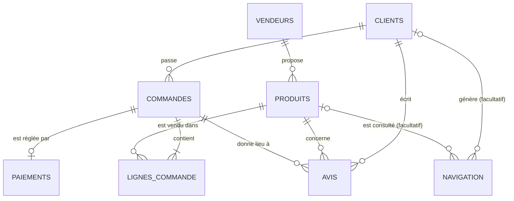

# Contrat de données SenMarket (Module 0)

Ce document décrit exactement ce que contiennent les 8 tables **telles que le code les produit** : colonnes, types, valeurs autorisées, clés, relations, unités. Les Modules 1 à 4 s'appuient dessus. L'utilisation du pipeline est dans le `README.md`.

## 1. Trois décisions prises avant de générer quoi que ce soit

**Granularité.** Une ligne de `commandes` est un ticket entier. Une ligne de `lignes_commande` est un produit dans ce ticket. Le « panier » d'une commande est donc la somme de ses lignes, jamais la valeur d'une seule ligne.

**Identifiants.** Chaque entité a un identifiant texte stable avec préfixe, suivi de chiffres complétés par des zéros (ex. `CMD00000001`). Un nom n'est jamais une clé : deux clients homonymes seraient fusionnés.

**Prix.** Le prix de catalogue est dans `produits`. Le prix payé est dans `lignes_commande` et peut différer du catalogue de ±10 %. Le catalogue peut changer sans réécrire l'historique.

## 2. Schéma des relations



## 3. Les tables

Types : texte, entier, date (`AAAA-MM-JJ` dans les CSV, vraie date dans le Parquet), booléen. PK = clé primaire, FK = clé étrangère.

### clients (une ligne = un client)
| Colonne | Type | Règle |
|---|---|---|
| client_id | texte, PK | `CLI` + 7 chiffres (`CLI0000001`) |
| nom_client | texte | obligatoire : une ligne sans nom est rejetée |
| email | texte, facultatif | nom sans accents + numéro du client + domaine : unique ; donnée personnelle synthétique |
| telephone | texte, facultatif | format `+221 7x xxx xx xx` (x = 0, 5, 6, 7 ou 8) ; donnée personnelle synthétique |
| ville, region | texte | si vide : remplacé par « Inconnue » (affichée à part dans les analyses) |
| date_inscription | date | sur les 730 derniers jours avant `--run-date` |

### vendeurs (une ligne = un vendeur)
| Colonne | Type | Règle |
|---|---|---|
| vendeur_id | texte, PK | `VEN` + 5 chiffres (`VEN00001`) |
| nom_vendeur, ville, region | texte | |

### produits (une ligne = un produit du catalogue)
| Colonne | Type | Règle |
|---|---|---|
| produit_id | texte, PK | `PRO` + 4 chiffres (`PRO0001`) |
| nom_produit | texte | appartient obligatoirement à sa catégorie (voir §6) |
| categorie | texte | Alimentation, Boissons, Hygiène, Électronique, Vêtements, Fournitures, Maison |
| vendeur_id | texte, FK → vendeurs | |
| prix_catalogue_xof | entier | fixe par produit (de 500 à 85 000) ; rejeté si ≤ 0 ou > 1 000 000 |
| actif | booléen | |

### commandes (une ligne = un ticket entier)
| Colonne | Type | Règle |
|---|---|---|
| commande_id | texte, PK | `CMD` + 8 chiffres (`CMD00000001`) |
| client_id | texte, FK → clients | |
| date_commande | date | entre la date d'inscription du client et `--run-date` ; postérieure à `--run-date` : rejet |
| statut | texte | `livrée`, `expédiée`, `en_preparation`, `annulée` |

### lignes_commande (une ligne = un produit dans un ticket)
| Colonne | Type | Règle |
|---|---|---|
| ligne_commande_id | texte, PK | `LC` + 9 chiffres (`LC000000001`), différent pour chaque ligne |
| commande_id | texte, FK → commandes | identique pour toutes les lignes d'un même ticket |
| produit_id | texte, FK → produits | |
| quantite | entier | de 1 à 5 ; rejeté si ≤ 0 |
| prix_unitaire_xof | entier | prix réellement payé : catalogue ±10 % |
| montant_xof | entier | = quantite × prix_unitaire_xof |

### paiements (une ligne = une tentative de paiement)
| Colonne | Type | Règle |
|---|---|---|
| paiement_id | texte, PK | `PAI` + 8 chiffres |
| commande_id | texte, FK → commandes | au plus un paiement par commande (environ 2 % des commandes n'en ont aucun) |
| methode_paiement | texte | `Wave`, `Orange Money`, `Carte bancaire`, `Espèces` |
| statut_paiement | texte | `réussi`, `en_attente`, `échoué` |
| montant_xof | entier | égal à la somme des lignes de la commande, sauf environ 1 % des paiements (frais ou remise de 2 % à 10 %) ; rejeté si négatif |
| date_paiement | date | = date de la commande |

### avis (une ligne = un avis client)
| Colonne | Type | Règle |
|---|---|---|
| avis_id | texte, PK | `AVI` + 8 chiffres |
| client_id, produit_id, commande_id | texte, FK | le client est celui de la commande ; le produit fait partie de la commande ; la commande est `livrée` |
| note | entier | de 1 à 5 ; rejeté sinon |
| date_avis | date | entre la date de la commande et `--run-date` |

### navigation (une ligne = un événement de navigation)
| Colonne | Type | Règle |
|---|---|---|
| evenement_id | texte, PK | `EVT` + 9 chiffres |
| session_id | texte | `SES` + 9 chiffres |
| client_id | texte, FK, facultatif | vide = visiteur anonyme (environ 20 % des événements) |
| produit_id | texte, FK, facultatif | vide = événement sans produit (environ 7 %) |
| type_evenement | texte | `page_vue`, `recherche`, `vue_produit`, `ajout_panier`, `debut_paiement` |
| date_evenement | date | |

## 4. Un ticket, deux tables

Le ticket `CMD00000001` est 1 ligne dans `commandes` et 3 lignes dans `lignes_commande` (prix du catalogue pour simplifier) :

| ligne_commande_id | commande_id | produit_id | quantite | prix_unitaire_xof | montant_xof |
|---|---|---|---|---|---|
| LC000000001 | CMD00000001 | PRO0001 (Riz brisé) | 2 | 12500 | 25000 |
| LC000000002 | CMD00000001 | PRO0002 (Huile végétale) | 1 | 6000 | 6000 |
| LC000000003 | CMD00000001 | PRO0003 (Sucre) | 3 | 1000 | 3000 |

- `commande_id` ne change pas : c'est la FK qui rattache les 3 lignes au même ticket.
- `ligne_commande_id` change à chaque ligne.
- Panier de la commande = 25 000 + 6 000 + 3 000 = 34 000 XOF.
- Moyenne par ligne = 11 333 XOF : ce n'est **pas** le panier moyen.
- Panier moyen : sommer d'abord par `commande_id`, puis faire la moyenne des totaux.

## 5. Où vit chaque information

| Information | Table.colonne |
|---|---|
| Ce qui a été demandé | `lignes_commande` (ne dit jamais si c'est payé) |
| État de la commande | `commandes.statut` |
| État du paiement | `paiements.statut_paiement` |
| Prix de catalogue (peut changer) | `produits.prix_catalogue_xof` |
| Prix payé (figé) | `lignes_commande.prix_unitaire_xof` |

`paiements.montant_xof` duplique la somme des lignes de la commande. En cas d'écart, la source de vérité de ce qui a été commandé est `lignes_commande`.

## 6. Cohérence produit / catégorie

Un produit appartient à une seule catégorie, définie à la source (`CATALOGUE` dans `generateur.py`). « Sucre » ne peut pas être en « Vêtements ». `tests/test_generateur.py` vérifie que chaque `nom_produit` figure dans la liste de sa `categorie`, et qu'un nom n'apparaît que dans une catégorie.

## 7. Trois définitions du chiffre d'affaires

Le mot « CA » seul est ambigu. On emploie toujours un de ces trois noms.

| Nom | Définition | Source |
|---|---|---|
| **CA commandé** (référence du projet) | somme de `montant_xof` des lignes acceptées, quel que soit le statut | `lignes_commande` |
| **CA réalisé** | somme de `montant_xof` des lignes dont la commande est `livrée` | `lignes_commande` + `commandes` |
| **CA encaissé** | somme de `montant_xof` des paiements `réussi` | `paiements` |

Une commande `annulée` est comptée dans le CA commandé : ce n'est pas de l'argent encaissé.

## 8. Intégrité

- Clé primaire unique dans chaque table de `data/processed`.
- Aucune clé étrangère orpheline : une ligne dont le parent est rejeté est rejetée aussi (cascade).
- Pour chaque table : lignes brutes = lignes acceptées + lignes rejetées.
- Argent en XOF, entier (pas de centimes en franc CFA).
- Colonnes volontairement absentes : `stock`, `commentaire`, `reference_transaction` (créées au Module 1).

## 9. Écarts voulus et limites connues

Écarts métier voulus (ce ne sont pas des défauts, ils ne vont pas en quarantaine) :

- Environ 2 % des commandes n'ont aucun paiement.
- Environ 1 % des paiements ont un montant différent de la somme des lignes (frais ou remise). Ces écarts servent au Module 1 : rapprochement des paiements et du chiffre d'affaires.

Limites connues :

- Aucun paiement orphelin (pas de défaut qui pointe vers une commande inexistante).
- Un seul paiement par commande, même quand il est échoué (pas de nouvelle tentative).
- Quantités et notes tirées uniformément de 1 à 5, sans loi de popularité.
- Noms générés avec le locale `fr_FR`, pas avec des noms sénégalais.

## 10. Organisation des données : les partitions

Une **partition** est un dossier qui représente un lot de données, nommé `date=AAAA-MM-JJ`. Chaque exécution du pipeline avec `--run-date AAAA-MM-JJ` écrit dans les dossiers de cette date et n'écrase jamais les autres.

```
data/
├── raw/date=AAAA-MM-JJ/         brut (sale) : 8 CSV, bilan_generation.csv, senmarket.log
├── processed/date=AAAA-MM-JJ/   propre : CSV, Parquet (types propres), JSON Lines, analyses/
└── rejected/date=AAAA-MM-JJ/    quarantaine : lignes rejetées avec leur raison, bilans
```

Deux axes se croisent : l'**étape** (brut, propre, rejeté) et le **lot** (la date). Pour savoir ce qu'est devenue une ligne, on compare les trois dossiers de la même date.

### Pourquoi partitionner

- **Ne rien écraser** : traiter aujourd'hui ne fait pas disparaître hier.
- **Rejouer un seul lot** : on relance une date sans toucher aux autres (au Module 5, un backfill de 30 jours répète la même opération sur 30 dates).
- **Lire seulement ce qu'il faut** : avec des millions de lignes, Spark ou DuckDB n'ouvrent que les dossiers utiles au lieu d'un fichier unique énorme. Le nom `clé=valeur` est un standard qu'ils reconnaissent, et la date devient une colonne.
- **Comprendre une anomalie** : brut, propre et rejeté partagent la même date.

### Nos deux partitions

| Partition | Taille | Rôle |
|---|---|---|
| `date=2026-10-29` | 10 000 lignes de commande | travail quotidien, tests, analyses |
| `date=2026-11-02` | 200 000 lignes de commande | « volume » : mesures de performance (index, temps de lecture) au Module 1 |

Sur 10 000 lignes, une base répond en quelques millisecondes avec ou sans index : seules les mesures sur la grosse partition prouvent quelque chose.

### Ce que veut dire la date d'un dossier

Dans ce TP, la date du dossier est la date d'exécution (`--run-date`), pas celle des commandes : chaque lancement génère environ deux ans d'historique qui se terminent à cette date. Dans un vrai projet, la partition du 30 ne contiendrait que ce qui est arrivé le 30. Les périodes de nos deux partitions se chevauchent donc : ce sont **deux jeux de test indépendants**, pas deux jours de la même boutique.

### Reproductibilité

La graine aléatoire dérive de la date : `[SENMARKET_SEED, AAAAMMJJ]` (par exemple `[42, 20261029]`).

- Même date et mêmes paramètres : mêmes fichiers (empreintes `sha256` identiques).
- Dates différentes : jeux indépendants (clients, noms et montants différents).

### Règle à retenir

Les identifiants se répètent d'une partition à l'autre : `CLI0000001` existe dans les deux, pour deux personnes différentes. **Ne jamais charger deux partitions dans les mêmes tables** (au Module 1, la partition volume va dans son propre schéma PostgreSQL).

Créer une partition : `python scripts/run_pipeline.py --run-date AAAA-MM-JJ --generer --rows 10000`.
